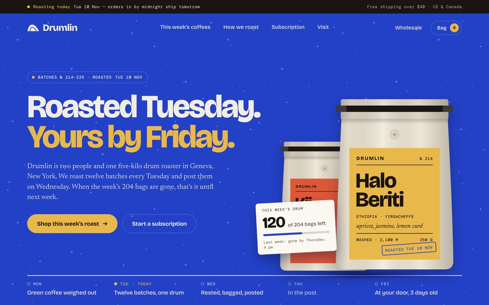
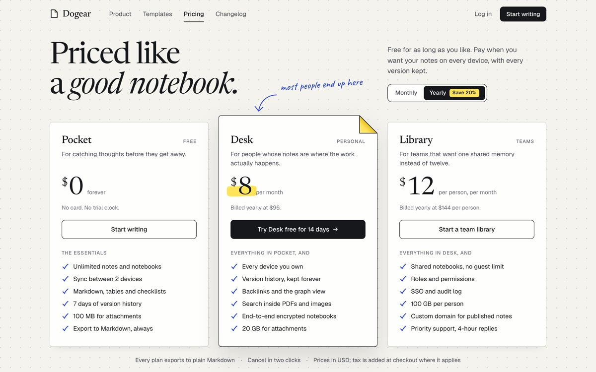
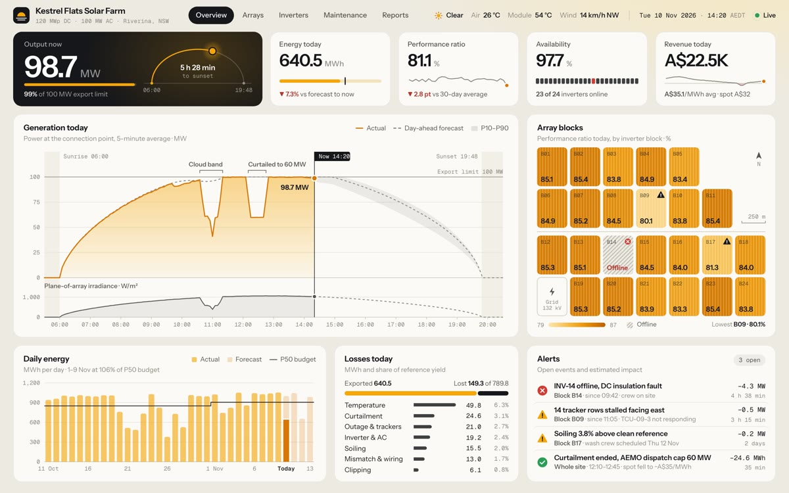
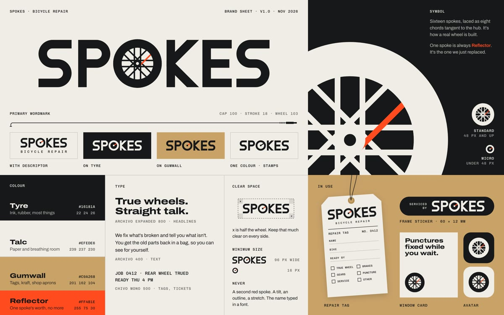
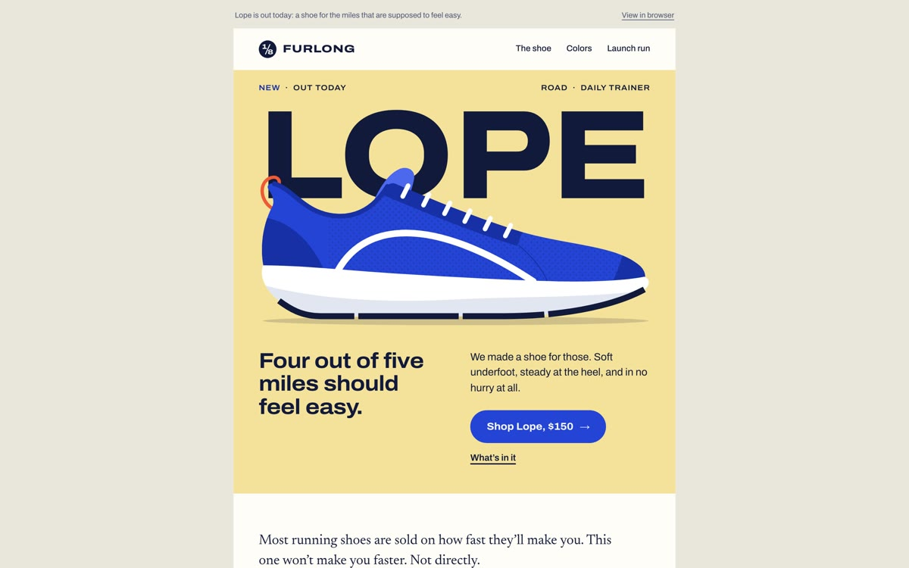
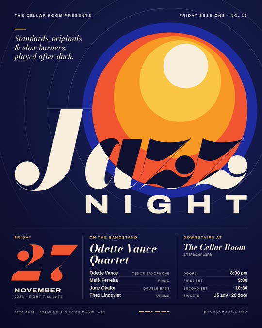
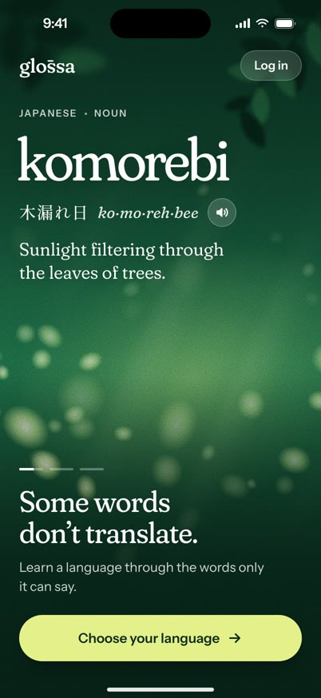
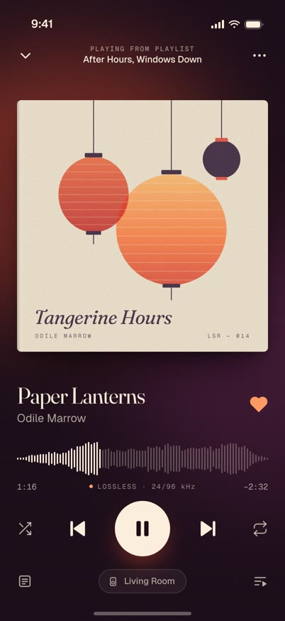
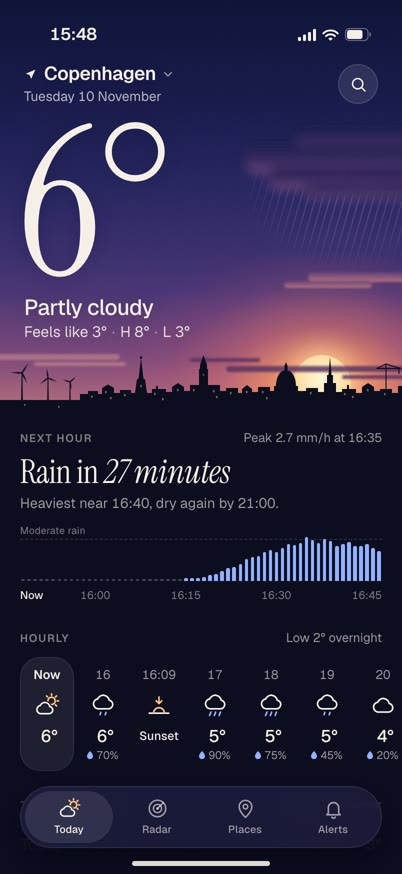

# fable designed 9

Nine screens, one prompt each, made by **Claude Fable 5.2** in Claude Code. No designer, no Figma, and no edits afterwards. Every `index.html` in this repo is exactly what the model wrote.

The model never saw its own work. It had file tools only (`Write`, `Edit`, `Read`) and no browser, so each screen was written blind.

## The prompts

Each run got one short line, plus the same closing lines:

```
<the line from the table>

One self-contained index.html in this folder. No external files except Google Fonts. It will be viewed at <W>×<H>. Work only inside this folder.
```

| # | prompt | viewport | time |
|---|---|---|---|
| [01](01-landing) | A landing page for a small-batch coffee roaster. | 1440×900 | 18m 19s |
| [02](02-pricing) | A pricing page for a note-taking app. | 1440×900 | 9m 20s |
| [03](03-dashboard) | An analytics dashboard for a solar farm. | 1440×900 | 18m 41s |
| [04](04-onboarding) | The onboarding screen of a language-learning app. | 402×874 | 17m 14s |
| [05](05-player) | The now-playing screen of a music app. | 402×874 | 14m 54s |
| [06](06-weather) | The home screen of a weather app. | 402×874 | 14m 50s |
| [07](07-logo) | A logo and a one-page brand sheet for a bike repair shop called Spokes. | 1440×900 | 14m 35s |
| [08](08-poster) | A poster for a jazz night. | 1080×1350 | 9m 36s |
| [09](09-email) | A launch email for a new running shoe. | 1440×900 | 14m 40s |

"Time" is the wall-clock time of the whole run, from the prompt to the finished file.

## What came out

| | | |
|---|---|---|
|  |  |  |
|  |  |  |
|  |  |  |

## Run it yourself

Open any `index.html` in a browser at the viewport in the table.

To repeat a run, use Claude Code in an empty folder:

```sh
claude -p --model claude-fable-5-2 --allowedTools "Write,Edit,Read" < PROMPT.txt
```

Each folder has its exact `PROMPT.txt`.

## Notes

- All brand names in the pages were made up by the model: Drumlin, Dogear, Kestrel Flats, glossa, Furlong and others. "Spokes" was the only name given in a prompt.
- The 9 runs went 5 at a time on one Mac, through a regular Claude Code subscription.

MIT licensed. By [@masamunecode](https://x.com/masamunecode).
